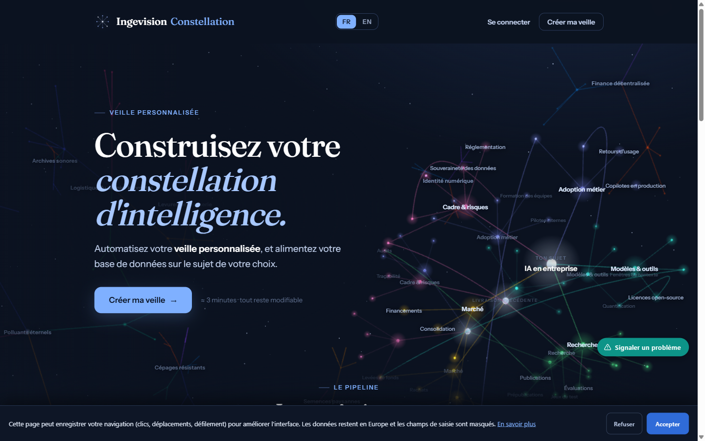
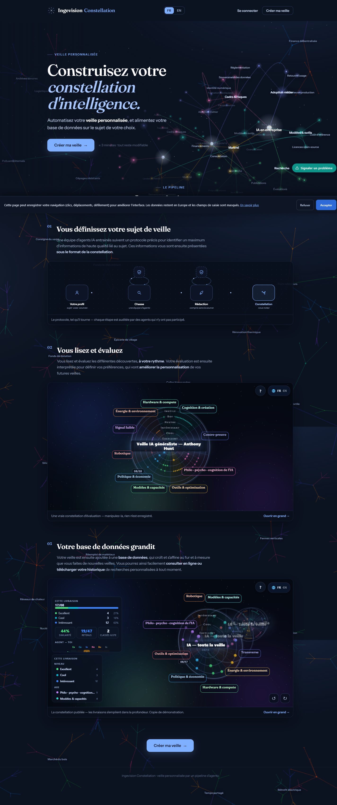

# Constellation

**An autonomous market-intelligence pipeline: ~90 LLM agents, nine gated stages, and a 3D map of what actually matters in your field.**

Live product → **[constellation.ingevision.cloud](https://constellation.ingevision.cloud)**



---

## The problem

Automated market intelligence produces one of two failures. Keyword tools (Feedly, Google Alerts) return everything that matches a string — high recall, no judgment. Ask an LLM to "summarize this week in AI" and you get a plausible, unfalsifiable digest with no way to tell a real signal from a confident hallucination.

Neither learns what *this particular reader* considers worth their time.

Constellation is a production system that addresses all three: it researches a topic with a cast of specialised agents, verifies findings adversarially, and renders the result as a navigable constellation rather than a wall of text. Readers rate what they find useful, and the next run is measurably sharper.

## What it does

A run takes a subject definition and an *owner profile* — who is reading, and through which lens — and produces a published, bilingual intelligence map.

| | |
|---|---|
| **Research** | A cast of hunter agents works assigned axes of the subject in parallel. Each hunter is shadowed by an independent verifier that never sees the hunter's reasoning. |
| **Verification** | Claims are checked against sources by agents that did not produce them. A finding that survives is promoted; one that does not is dropped with a recorded reason. |
| **Synthesis** | Surviving findings are written up in French and English, then linked to each other — the links are what turn a list into a map. |
| **Review** | The reader rates findings on the published constellation. This is the one deliberate human checkpoint in the pipeline. |
| **Learning** | Ratings are converted into per-axis preference rules, then **back-tested against the reader's own past rankings — a rule that fails to reproduce them is discarded, not shipped.** |



## Engineering decisions worth stealing

**Deterministic gates, not agent self-report.** Every stage is bounded by a validator — a plain Python program that inspects the artefacts on disk and either passes or refuses. An agent claiming to have finished proves nothing; the gate is the only thing that advances the run. This single choice removed the entire class of "I believe I completed that" failures that makes long agent chains untrustworthy.

**Induced rules must earn their place.** The preference learner does not simply ask a model to describe the reader's taste. It induces candidate rules, replays them against the ratings already collected, and keeps only those that reconstruct the reader's actual ranking. Preference learning that is never back-tested is just a model agreeing with itself.

**Idempotent resume.** Runs are long and failure is normal. Re-invoking the orchestrator skips every stage already green and resumes at the first that is not — so a crash costs the failed stage, never the run.

**One canonical template, propagated.** Every published page in the system is served from a single root template; only data is per-run. A visual fix is made once and pushed everywhere in one command, which is why the twentieth run looks exactly like the first.

**Bilingual at the data layer.** Findings carry both languages as first-class fields rather than being translated at render time, so the FR/EN toggle is instantaneous and neither language is a second-class citizen.

## Architecture

```
subject + owner profile
   │
   ├─ pre-flight      workspace, profile, agent casting are coherent
   ├─ hunt            parallel hunter agents across the subject's axes
   ├─ verification    independent agents re-check every claim
   ├─ constellation   bilingual write-up + the link graph between findings
   ├─ notification    the reader is told their map is ready
   ├─ rating          ◀── human checkpoint: the reader scores what landed
   ├─ feedback        induce per-axis rules, back-test, keep survivors
   ├─ publish         multi-tenant portal, one shared root template
   └─ debrief         cost, duration and token accounting per stage
   │
   └─ every arrow above is a blocking validator, not a handoff
```

Each stage runs headless, writes its artefacts to a run workspace, and is admitted to the next stage only by its validator. A monitoring daemon regenerates the run report every few seconds, so a live dashboard shows exactly which stage is executing and which gate is holding.

**Stack** — Node.js service in Docker behind Traefik · three.js for the constellation view · headless agent orchestration in Bash + Python validators · deployed on a self-hosted VPS with per-tenant data isolation.

## Status

In production. Multiple real subjects run on it, including a live feed for an external reader, with the portal, the rating loop and the learning pass all exercised end to end.

## Why the source is not here

Constellation is a commercial product, and the parts that make it work — the agent contracts, the verification protocol, the rule-induction pass — are the product. This repository documents the system, its architecture and the decisions behind it. The running system is public and free to explore at [constellation.ingevision.cloud](https://constellation.ingevision.cloud); that is the honest demonstration.

Happy to walk through any of it in detail — including the parts not written down here — with anyone evaluating a collaboration.

---

**Anthony Hunt** — independent consultant, applied agentic AI.
Multi-agent systems in production · LLM orchestration · AI × immersive.
📧 [anthony.hunt@yahoo.fr](mailto:anthony.hunt@yahoo.fr)

© 2026 Anthony Hunt. Text and images in this repository are provided for evaluation; the described system is proprietary.
