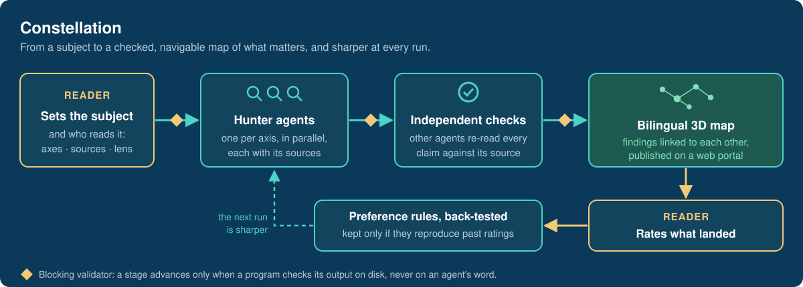
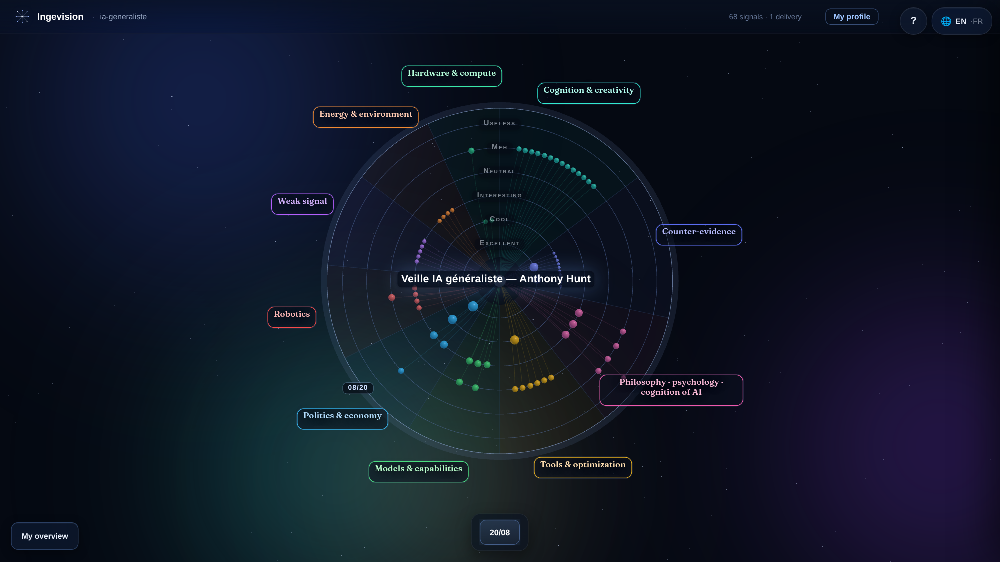
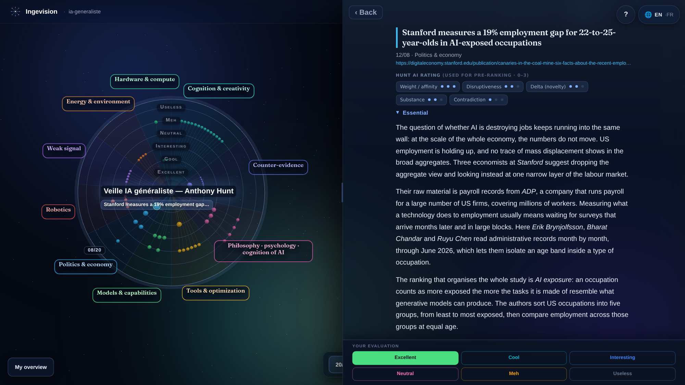
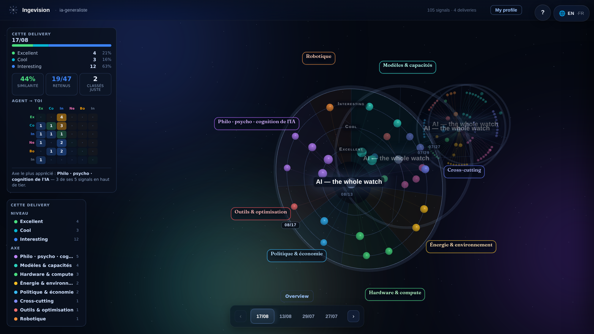
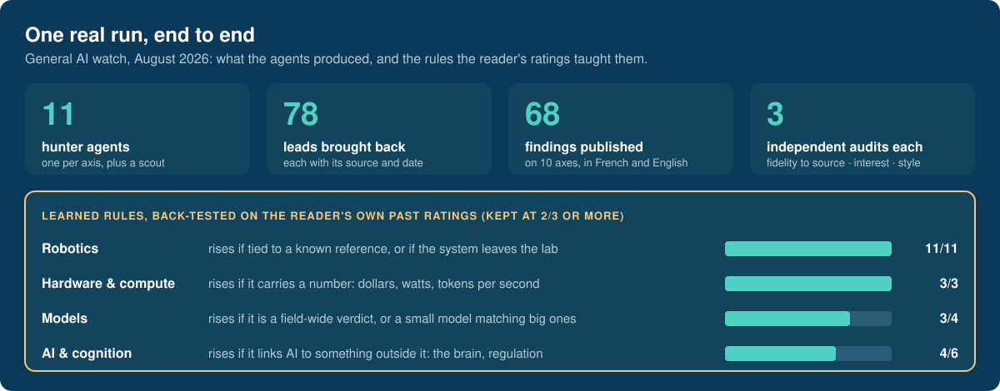

# Constellation

**An autonomous research pipeline: AI agents research a subject, check each other's findings against their sources and publish a navigable map of what matters, which gets sharper with every rating the reader gives.**

**[Explore the live demo](https://constellation.ingevision.cloud)**: two example constellations, in the browser, nothing to install and nothing you do is saved.

## Why

Keyword alerts return everything that matches. An LLM digest returns a plausible summary that nobody can check. Constellation sits in between: specialised agents do the reading, other agents verify it against the sources, and the reader's ratings teach the next run what is worth their time. A run uses about ninety agents.

## What the reader sees

**1. Rate the delivery.** Each star is a finding, placed on its axis and at the level the agents pre-ranked it; the reader gives their own verdict.

**2. Open any finding.** Headline, source link, the agents' scores and a sourced summary, in English or French.

**3. Watch it learn.** Deliveries stack up into a base the reader can search. The side panel compares the agents' ranking with the reader's.

Demonstration copy of a real watch on general AI, shared by its owner. Some labels of the demo data are still in French.

## The evidence

Counts from the run behind the 20 August 2026 delivery, the one shown in the rating view above. A preference rule is written only if it was tested on at least three past ratings and reproduces at least two thirds of them.

## Design principles

| | |
|---|---|
| **Gates, not self-report** | Every stage is closed by a plain program that checks the files it produced. An agent saying "done" moves nothing. |
| **Checked by someone else** | The agents that verify a finding never wrote it. |
| **Rules must earn their place** | A preference rule is kept only if it reproduces the reader's past ratings. |
| **Resume, don't restart** | A crashed run restarts at the first stage that is not green. |
| **One template** | Every published page comes from one shared template, so a fix is made once and reaches every reader. |

## Status

In production. Several watches run on it, including one for an external reader, with the portal, the rating loop and the learning pass used end to end.

Stack: Node.js in Docker behind Traefik · three.js · headless agents orchestrated in Bash with Python validators · self-hosted server, data isolated per reader.

## Why the source is not here

Constellation is a commercial product: the agent contracts, the verification protocol and the rule-learning pass are the product. The live demo is the honest demonstration. Happy to walk through any of it in detail with anyone evaluating a collaboration.

---

**Anthony Hunt** — applied agentic AI: evaluating, training and deploying specialised agents.
[GitHub profile](https://github.com/anthohunt) · [anthony.hunt@yahoo.fr](mailto:anthony.hunt@yahoo.fr)

© 2026 Anthony Hunt. Text and images are provided for evaluation; the described system is proprietary.
